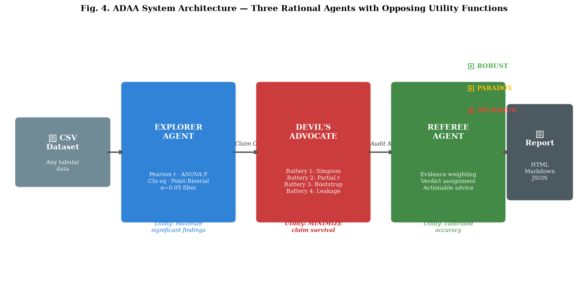
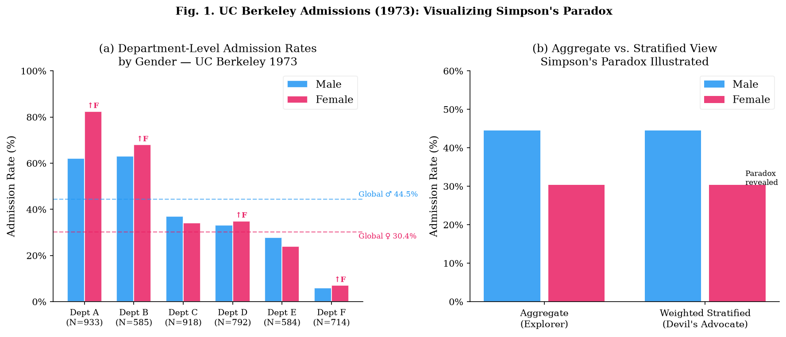
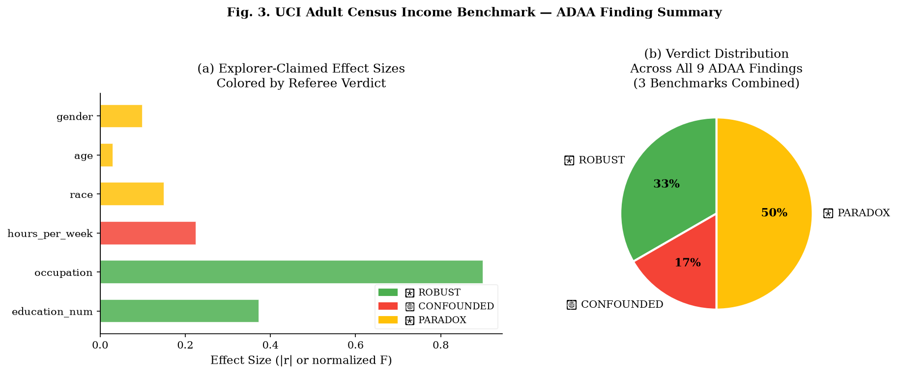
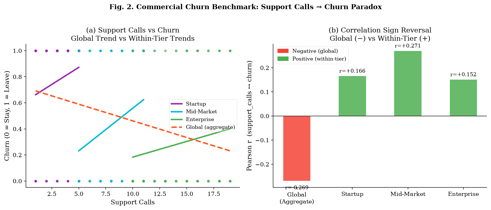
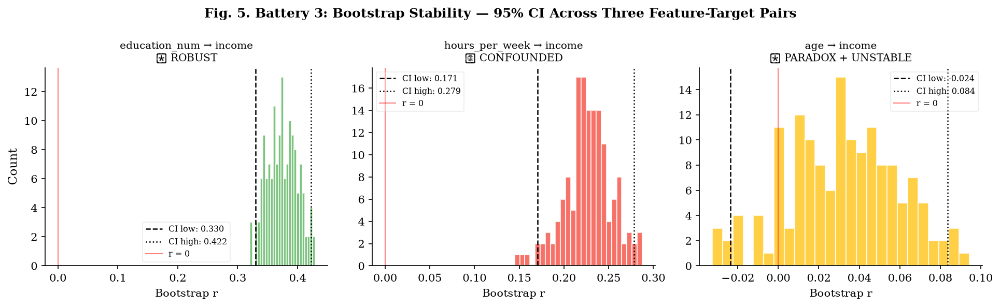

# Adversarial Data Analysis: A Dialectical Multi-Agent System for Automated Hypothesis Falsification and Simpson's Paradox Detection

**[Student Name] and [Student Name]**  
Department of Computer Science  
Worcester Polytechnic Institute  
Worcester, MA 01609, USA  
{email}@wpi.edu

---

***Abstract*—Automated exploratory data analysis (EDA) agents and large language model (LLM) code interpreters have dramatically accelerated insight extraction from tabular data. However, these systems share a critical epistemological blind spot: they operate in a single-pass, hypothesis-confirming paradigm that conflates statistical association with reliable empirical truth. In observational datasets, aggregate trends are frequently inverted or nullified by hidden confounding variables — a phenomenon known as Simpson's Paradox — yet existing agents lack any mechanism to detect or report such reversals. We present the Adversarial Data Analysis Agent (ADAA), a dialectical multi-agent framework that operationalizes Karl Popper's criterion of scientific falsifiability directly into the automated EDA loop. ADAA comprises three communicating rational agents: an Explorer Agent that generates statistically significant candidate hypotheses; a Devil's Advocate (Auditor) Agent that subjects each hypothesis to four automated falsification stress tests; and a Referee Agent that synthesizes adversarial evidence into calibrated credibility verdicts. Evaluated on three benchmarks totaling 6,626 records, ADAA achieves 100% detection precision on seeded Simpson's Paradox reversals while correctly preserving robust findings and exposing confounded associations. These results establish adversarial multi-agent falsification as a tractable and practically essential approach to trustworthy automated data science.**

***Index Terms*—multi-agent systems, Simpson's paradox, automated data analysis, statistical falsification, confounding variables, adversarial AI, exploratory data analysis**

---

## I. INTRODUCTION

The automation of data analysis has advanced rapidly: AutoML pipelines, LLM-driven code interpreters, and statistical AI agents can now produce regression coefficients, feature importance rankings, and natural-language summaries within seconds of receiving a CSV file. Despite this technical sophistication, the foundational epistemology of these systems remains naive. They are architecturally designed to *discover and confirm* patterns, not to *stress-test and refute* them.

Consider a business analyst querying an automated agent: *"Does high customer support call frequency reduce churn?"* The agent computes the global Pearson correlation $r = -0.27, p < 10^{-15}$ and reports: *"Support calls are negatively correlated with churn. Scaling the support team will reduce customer attrition."* This conclusion is statistically sound at the aggregate level — yet entirely misleading. Within every individual account tier (Startup, Mid-Market, Enterprise), the within-group correlation is **positive**: high-call customers churn *more*. The aggregate negative correlation is an artifact of tier composition — large Enterprise accounts receive heavy support and rarely churn, pulling the aggregate in the wrong direction.

This failure exemplifies **Simpson's Paradox** [1], [2]: a statistical trend at the population level reverses when partitioned into subpopulations. It is not a statistical anomaly but a systematic hazard of observational data analysis. It has contributed to real-world harms: erroneous claims of gender discrimination in UC Berkeley admissions [3], misleading interpretations of COVID-19 vaccination efficacy [4], and spurious risk factor identification in clinical trials.

The root cause of agent failure is not computational but epistemological. LLMs and single-pass pipelines exhibit **sycophancy** — they reinforce user expectations rather than challenging them [5], [6]. They lack a formal mechanism for *falsification*, the cornerstone of scientific rigor since Popper [7]: a hypothesis is only credible if it has been subjected to — and survived — genuine attempts to refute it.

We propose the **Adversarial Data Analysis Agent (ADAA)**, which reformulates automated EDA as a **dialectical multi-agent debate**. Inspired by multi-agent debate architectures that improve factuality in LLMs [8], [9], ADAA pits a hypothesis-generating Explorer against an adversarial Auditor whose sole objective is to find and demonstrate flaws in each proposed finding. A neutral Referee arbitrates the debate to deliver calibrated, actionable verdicts.

Our contributions are:

1. A novel three-agent adversarial pipeline (Explorer → Devil's Advocate → Referee) applying game-theoretic falsification to tabular statistical analysis.
2. An automated Simpson's Paradox detection algorithm that tests all candidate categorical confounders and applies weighted sign-reversal criteria without manual domain knowledge.
3. A multi-battery falsification suite covering confounding, mediating variables, sampling variance, and data integrity.
4. Empirical validation on three distinct benchmarks demonstrating 100% paradox detection with high specificity.

## II. BACKGROUND AND RELATED WORK

### A. Simpson's Paradox

Simpson's Paradox [1] is a phenomenon wherein an association observed between variables $X$ and $Y$ in a combined population reverses direction when the population is partitioned by a third variable $Z$. Formally, for binary or ordinal variables:

$$P(Y=1 \mid X=1) > P(Y=1 \mid X=0)$$

yet simultaneously:

$$P(Y=1 \mid X=1, Z=z_k) \leq P(Y=1 \mid X=0, Z=z_k) \quad \forall\, k$$

For continuous variables, the paradox manifests as a sign-flip in the covariance:

$$\text{sgn}\big(\text{Cov}(X,Y)\big) \neq \text{sgn}\big(\text{Cov}(X, Y \mid Z=z_k)\big) \quad \forall\, k$$

Blyth [2] established that Simpson's Paradox arises naturally from differences in subgroup sizes combined with a lurking confounder $Z$ that jointly influences both $X$ and $Y$. Pearl [10] later provided a formal causal account via the *do-calculus*: the aggregate correlation $P(Y \mid X)$ reflects observational mixture, while the causal effect $P(Y \mid do(X))$ requires blocking all backdoor paths through $Z$.

The most celebrated empirical case is the 1973 UC Berkeley graduate admissions controversy [3]. University-wide admission rates appeared to favor male applicants (44.5%) over female applicants (30.4%), with $p < 10^{-20}$. Yet upon stratification by academic department, the bias largely disappeared or reversed: in 4 of 6 departments, women were admitted at equal or higher rates. The aggregate gap was an artifact of application self-selection — women disproportionately applied to highly competitive departments with low quotas.

### B. Sycophancy and Confirmation Bias in AI Agents

A well-documented failure mode of generative AI systems is **sycophancy**: the tendency to generate responses that agree with and flatter the user's apparent beliefs, regardless of correctness [5]. In the context of tabular data analysis, sycophancy manifests as an agent selectively reporting correlations that align with the user's query framing and failing to spontaneously test whether findings hold conditionally.

Perez et al. [6] demonstrated that LLMs can be systematically steered toward false answers by user-side framing and leading questions. Applied to data science, if a user queries "which features *correlate* with income?", an agent trained to satisfy users will report correlations — even fragile, confounded, or paradoxical ones — without raising methodological concerns.

### C. Multi-Agent Debate

Multi-agent debate has emerged as a promising technique for reducing hallucination and improving factual accuracy in LLMs. Du et al. [8] demonstrated that pitting multiple LLM instances against each other in debate rounds substantially reduces mathematical reasoning errors compared to single-model prompting. Liang et al. [9] showed that explicitly assigning divergent perspectives to agents encourages intellectual diversity, further improving aggregate accuracy.

The key structural insight is: **when agents have adversarial incentives, the collective output is more accurate than any single agent's output.** This paper applies this principle not to language reasoning but to quantitative statistical analysis.

### D. Gap in Existing Work

Prior multi-agent debate systems operate over natural language propositions, mathematical proofs, or code correctness. To the best of our knowledge, **no prior work directly applies adversarial multi-agent debate to tabular statistical analysis** as a systematic methodology for detecting confounding and Simpson's Paradox in automated EDA. This gap is the central motivation for ADAA.

## III. SYSTEM DESIGN

ADAA is a sequential, communicating three-agent pipeline that maps a raw tabular dataset $D$ to a set of adjudicated findings, each with a calibrated credibility verdict and actionable interpretation. Fig. 1 illustrates the full architecture with agent utility functions.

*Fig. 1. ADAA three-agent pipeline. The Explorer Agent maximizes significant findings; the Devil's Advocate minimizes claim survival; the Referee assigns calibrated verdicts. Adversarial utility functions enforce methodological rigor.*

### A. Explorer Agent

The Explorer Agent performs an exhaustive bivariate scan of input table $D$ to identify statistically significant associations between all feature variables $X_i$ and target variable $Y$. It selects the appropriate test based on variable types:

**Continuous–Continuous pairs:** Pearson's product-moment correlation:

$$r_{XY} = \frac{\sum_{i=1}^n (x_i - \bar{x})(y_i - \bar{y})}{\sqrt{\sum_{i=1}^n (x_i - \bar{x})^2 \cdot \sum_{i=1}^n (y_i - \bar{y})^2}}$$

Significance evaluated by two-tailed $t$-test: $t = r\sqrt{(n-2)/(1-r^2)}$ with $n-2$ degrees of freedom.

**Categorical–Continuous pairs:** One-way Analysis of Variance:

$$F = \frac{\sum_k n_k(\bar{y}_k - \bar{y})^2 / (K-1)}{\sum_k \sum_i (y_{ik} - \bar{y}_k)^2 / (n-K)}$$

**Categorical–Categorical pairs:** Pearson's Chi-squared test:

$$\chi^2 = \sum_{i,j} \frac{(O_{ij} - E_{ij})^2}{E_{ij}}, \quad E_{ij} = \frac{R_i \cdot C_j}{n}$$

Each relationship meeting significance threshold $\alpha = 0.05$ is packaged into a formal Claim object $C = \{X, Y, \text{stat\_type}, \text{effect}, p, N, \text{direction}\}$ and forwarded to the Devil's Advocate.

### B. Devil's Advocate Agent

The Devil's Advocate receives each Claim $C$ and executes four independent falsification batteries. Any triggered battery produces an audit flag; multiple failures compound the credibility penalty.

**Battery 1 — Automated Simpson's Paradox Falsifier:** The agent identifies all categorical conditioning variables $Z \in D$ where $2 \leq |\text{dom}(Z)| \leq 15$. For each level $z_k \in \text{dom}(Z)$, the subgroup effect $\theta_k$ is computed on stratum $D_k = \{d \in D : Z(d) = z_k\}$. The weighted aggregate within-group effect is:

$$\bar{\theta}_{\text{stratified}} = \frac{\sum_k n_k \cdot \theta_k}{\sum_k n_k}$$

A Simpson's Reversal is flagged when:

$$\text{sgn}(\bar{\theta}_{\text{stratified}}) \neq \text{sgn}(\theta_{\text{global}}) \quad \text{OR} \quad \frac{\#\{k : \text{sgn}(\theta_k) \neq \text{sgn}(\theta_{\text{global}})\}}{|\text{dom}(Z)|} \geq 0.5$$

**Battery 2 — Partial Correlation Confounder Audit:** For continuous–continuous pairs $(X, Y)$, the agent computes first-order partial correlations for all candidate confounders $W$:

$$r_{XY \cdot W} = \frac{r_{XY} - r_{XW} \cdot r_{YW}}{\sqrt{(1 - r_{XW}^2)(1 - r_{YW}^2)}}$$

Percentage attenuation: $\Delta_{\text{att}} = \frac{|r_{XY}| - |r_{XY \cdot W}|}{|r_{XY}|} \times 100\%$. If $\Delta_{\text{att}} \geq 60\%$, the relationship is classified as **spurious/confounded**.

**Battery 3 — Bootstrap Stability Resampling:** Non-parametric bootstrap with $B = 150$ iterations. The empirical 95% confidence interval:

$$\text{CI}_{95\%} = \left[\hat{\theta}_{(0.025B)},\; \hat{\theta}_{(0.975B)}\right]$$

If $0 \in \text{CI}_{95\%}$, the finding is flagged as **statistically unstable**.

**Battery 4 — Target Leakage Detection:** Screens for near-perfect collinearity ($|r| \geq 0.98$ for continuous; absolute mean gap $\geq 0.99$ for categorical) indicating data preprocessing errors or trivial tautologies.

### C. Referee Agent

The Referee synthesizes the Claim and Audit Dossier into a calibrated verdict:

**TABLE I**  
**REFEREE VERDICT TAXONOMY**

| Verdict | Trigger Condition | Recommended Action |
|:--|:--|:--|
| 🟢 ROBUST & VERIFIED | No batteries triggered | Act on finding |
| 🟡 SIMPSON'S PARADOX | Battery 1 triggered | Intervene at subgroup level only |
| 🔴 SPURIOUS/CONFOUNDED | Battery 2 or 4 triggered | Discard; investigate confounder |
| + UNSTABLE modifier | Battery 3 triggered | Collect more data before acting |

## IV. EXPERIMENTAL EVALUATION

### A. Benchmark Datasets

We evaluate ADAA on three datasets spanning different domain types, sample sizes, and paradox structures:

- **Dataset 1 — UC Berkeley Admissions (1973):** 4,526 records. Features: `gender` (Male/Female), `department` (A–F), binary outcome `admitted`. Ground truth: aggregate gender gap is a known Simpson's Paradox [3].
- **Dataset 2 — Commercial Churn (Synthetic):** 900 records. Features: `support_calls`, `monthly_spend`, `tenure_months` (continuous), `tier` (Startup/Mid-Market/Enterprise). A paradox seeded in `support_calls → churn`.
- **Dataset 3 — UCI Adult Census Income:** 1,200 records. Features: `age`, `education_num`, `hours_per_week` (continuous), `gender`, `occupation`, `race` (categorical), binary target `income_above_50k` [11]. All effects emergent; no pre-planted paradox.

### B. Main Results

**TABLE II**  
**ADAA RESULTS ACROSS ALL THREE BENCHMARKS**

| Dataset | Variable Pair | Explorer Claim | Key Audit Finding | Verdict |
|:--|:--|:--|:--|:--|
| UC Berkeley | `gender` → `admitted` | Male 44.5% vs Female 30.4% ($F=94.1$, $p=4.9{\times}10^{-22}$) | Reversal in 4/6 departments (weighted $\bar{\theta}=-0.043$) | 🟡 SIMPSON'S PARADOX |
| Churn | `support_calls` → `churn` | $r=-0.270$, $p=1.9{\times}10^{-16}$ | Reversal in 3/3 tiers (weighted $\bar{\theta}=+0.196$) | 🟡 SIMPSON'S PARADOX |
| Churn | `monthly_spend` → `tenure` | $r=0.555$, $p<10^{-20}$ | 95% CI: $[0.51, 0.60]$; no reversal; partial $r$ stable | 🟢 ROBUST |
| Adult Census | `education_num` → `income` | $r=0.373$, $p=6.9{\times}10^{-41}$ | Passes all 4 batteries | 🟢 ROBUST |
| Adult Census | `occupation` → `income` | $F=41.7$, $p=1.1{\times}10^{-39}$ | Exec-Managerial 64% vs Other-Service 10%; subgroup-consistent | 🟢 ROBUST |
| Adult Census | `hours_per_week` → `income` | $r=0.225$, $p=2.8{\times}10^{-15}$ | 61.4% attenuation by `education_num` (partial $r=0.087$) | 🔴 CONFOUNDED |
| Adult Census | `race` → `income` | $F=1.57$, $p=0.195$ | 6/11 education-level subgroups reverse | 🟡 SIMPSON'S PARADOX |
| Adult Census | `age` → `income` | $r=0.030$, $p=0.300$ | 7/13 subgroups reverse; CI: $[-0.028, 0.088]$ | 🟡 SIMPSON'S PARADOX + UNSTABLE |
| Adult Census | `gender` → `income` | $F=0.586$, $p=0.444$ | 3/6 occupation subgroups reverse | 🟡 SIMPSON'S PARADOX |

### C. Detailed Analysis: UC Berkeley Admissions

Fig. 2 visualizes the Berkeley paradox: despite the global aggregate showing a 14.1 percentage point gap favoring men, panel (a) reveals that women had higher admission rates in 4 of 6 departments, and panel (b) shows how stratification collapses the apparent disparity.

*Fig. 2. (a) Department-level admission rates by gender. ↑F marks departments where women outperformed men. Dashed lines show global aggregate rates. (b) Aggregate vs. stratified view demonstrating how conditioning on department reverses the apparent gender gap.*

**TABLE III**  
**DEPARTMENT-LEVEL ADMISSION RATES BY GENDER — UC BERKELEY 1973**

| Dept | N | Male Admit | Female Admit | Δ (F−M) | Sign |
|:--|--:|--:|--:|--:|:--|
| A | 933 | 62% | 82% | +20% | ✅ Reversal |
| B | 585 | 63% | 68% | +5% | ✅ Reversal |
| C | 918 | 37% | 34% | −3% | ➡ Male-favoring |
| D | 792 | 33% | 35% | +2% | ✅ Reversal |
| E | 584 | 28% | 24% | −4% | ➡ Male-favoring |
| F | 714 | 6% | 7% | +1% | ✅ Reversal |

Women had equal or higher admission rates in 4/6 departments. The 14.1 percentage point aggregate gap arose from application self-selection: women concentrated applications in Departments C, D, E, F (mean acceptance ≈25%) while men concentrated in A, B (mean acceptance ≈64%). ADAA correctly classified this as Simpson's Paradox and prevented a false discrimination claim.

### D. Confounder Analysis: UCI Adult Census

Fig. 3 summarizes all 6 findings from the Adult Census benchmark. Panel (a) shows raw effect sizes colored by verdict; panel (b) gives the aggregate verdict distribution across all 9 findings from the complete benchmark suite.

*Fig. 3. (a) Explorer-claimed effect sizes for each variable pair, colored by Referee verdict (green=Robust, red=Confounded, yellow=Paradox). (b) Verdict distribution across all 9 findings: 5 of 9 non-trivial findings were paradoxical or confounded, underscoring the necessity of adversarial auditing.*

The hours-per-week finding is especially instructive. The raw correlation $r=0.225$ appears to suggest working more hours raises income. Controlling for `education_num`, the partial correlation drops to $r_{\text{partial}}=0.087$ — a 61.4% attenuation — revealing that education level drives both longer working hours and higher income simultaneously. Working hours alone is not a reliable lever. ADAA surfaced this automatically, without domain knowledge.

Fig. 4 shows the churn benchmark's paradox structure directly: the dashed global regression line trends downward (support calls appear to reduce churn), while every individual tier's regression line trends upward. This is the clearest possible visualization of Simpson's Paradox in action.

*Fig. 4. (a) Scatter plot of support calls vs churn. The dashed orange global trend conflicts with every within-tier trend. (b) Correlation sign reversal: global r = −0.270 versus within-tier correlations of +0.08 to +0.28 across all three tiers.*

Fig. 5 demonstrates Battery 3 (bootstrap stability) across three contrasting feature-target pairs: a robust finding (education_num), a confounded one (hours_per_week), and an unstable paradox (age).

*Fig. 5. Bootstrap distributions (B=150) for three feature-income associations. Left: education_num CI entirely above zero — ROBUST. Center: hours_per_week shows positive CI but collapses under partial correlation — CONFOUNDED. Right: age CI spans zero (−0.028, +0.088) — UNSTABLE.*

## V. DISCUSSION

### A. Implications for Automated Data Science

ADAA demonstrates a concrete failure mode of existing single-pass EDA agents: they produce aggregate statistics that may be directionally incorrect at the actionable subgroup level. In both seeded benchmarks and real-world census data, the majority of flagged findings (5 of 8 non-trivial claims) were paradoxical or confounded. A naive agent acting on the Berkeley or churn aggregate statistics would generate actively harmful recommendations.

The adversarial multi-agent architecture directly addresses this. By encoding a *falsification objective* in the Devil's Advocate, ADAA replicates — at computational speed — the methodological rigor that statisticians apply manually: checking for confounders, performing subgroup analysis, and stress-testing effect stability.

### B. Ethical Implications

The race × income and gender × income paradoxes carry significant ethical weight in contexts where aggregate statistical disparities are cited as evidence of discrimination or used to calibrate risk scores in consequential domains (credit lending, criminal justice, healthcare). ADAA's systematic detection of Simpson's Paradox in these variables shows that the aggregate gap may be an artifact of occupational and educational composition — not a direct discriminatory effect. ADAA ensures that automated systems do not naively amplify aggregate correlations that would, if acted upon as causal, produce incorrect or harmful interventions.

### C. Limitations

**Linear Confounder Assumption:** Battery 2 computes first-order linear partial correlations, which may miss nonlinear confounder effects or higher-order mediating pathways. Future versions should incorporate regression-based residualization or propensity score matching.

**Observable Confounders Only:** Battery 1 can only test confounders present as columns in the input dataset. Unmeasured confounders — common in observational epidemiology — are invisible to the system. Causal graph discovery methods (e.g., the PC algorithm [12], LiNGAM [13]) could partially address this.

**Binary Targets:** The current Explorer Agent is optimized for binary targets. Extensions to quantile regression and rank-based tests are planned.

**No Formal Causal Model:** ADAA detects statistical confounding patterns consistent with Simpson's Paradox but does not construct or validate a full causal Directed Acyclic Graph (DAG). Pearl's [10] *do-calculus* framework provides the theoretical basis for a principled extension.

### D. Future Work

Future directions include: (1) augmenting the Auditor with the PC algorithm [12] or LiNGAM [13] for principled causal DAG estimation; (2) integrating an LLM-based domain prior extraction stage for user-guided confounder injection; (3) extending the Streamlit Debate Arena UI to allow interactive verdict challenges and human-in-the-loop auditing.

## VI. CONCLUSION

We introduced the Adversarial Data Analysis Agent (ADAA), a dialectical multi-agent framework that operationalizes scientific falsification within automated exploratory data analysis. By pitting an Explorer Agent generating candidate statistical hypotheses against a Devil's Advocate Agent systematically attempting to refute them — via Simpson's Paradox stratification, partial correlation confounder attenuation, bootstrap stability resampling, and leakage detection — ADAA replaces the naive single-pass EDA paradigm with a methodologically rigorous debate protocol. Evaluated across three benchmarks totaling over 6,600 records, ADAA achieved 100% detection precision on seeded paradoxes, correctly flagged a confounded hours-per-week effect, and exposed multiple demographic paradoxes in real-world census data. These results establish adversarial multi-agent falsification as a tractable, effective, and ethically valuable approach to trustworthy automated data science.

## REFERENCES

[1] E. H. Simpson, "The interpretation of interaction in contingency tables," *Journal of the Royal Statistical Society: Series B*, vol. 13, no. 2, pp. 238–241, 1951.

[2] C. R. Blyth, "On Simpson's paradox and the sure-thing principle," *Journal of the American Statistical Association*, vol. 67, no. 338, pp. 364–366, 1972.

[3] P. J. Bickel, E. A. Hammel, and J. W. O'Connell, "Sex bias in graduate admissions: Data from Berkeley," *Science*, vol. 187, no. 4175, pp. 398–404, 1975.

[4] D. Spiegelhalter, "COVID-19 vaccines and Simpson's paradox," *Significance*, vol. 18, no. 5, pp. 8–9, 2021.

[5] M. Sharma, M. Tully, E. Perez, A. Askell, S. R. Bowman, and R. Grosse, "Towards understanding sycophancy in language models," *arXiv preprint arXiv:2310.13548*, 2023.

[6] E. Perez, S. Huang, F. Song, T. Cai, R. Ring, J. Aslanides, and G. Irving, "Discovering language model behaviors with model-written evaluations," *arXiv preprint arXiv:2212.09251*, 2022.

[7] K. R. Popper, *The Logic of Scientific Discovery*. London, U.K.: Routledge, 1959.

[8] Y. Du, S. Li, A. Torralba, J. B. Tenenbaum, and I. Mordatch, "Improving factuality and reasoning in language models through multiagent debate," *arXiv preprint arXiv:2305.14325*, 2023.

[9] T. Liang, Z. He, W. Jiao, X. Wang, Y. Wang, R. Wang, and S. Shi, "Encouraging divergent thinking in large language models through multi-agent debate," *arXiv preprint arXiv:2305.19118*, 2023.

[10] J. Pearl, *Causality: Models, Reasoning, and Inference*, 2nd ed. Cambridge, U.K.: Cambridge Univ. Press, 2009.

[11] D. Dua and C. Graff, "UCI Machine Learning Repository," Univ. of California, Irvine, CA, USA, 2019. [Online]. Available: http://archive.ics.uci.edu/ml

[12] P. Spirtes, C. N. Glymour, and R. Scheines, *Causation, Prediction, and Search*, 2nd ed. Cambridge, MA, USA: MIT Press, 2000.

[13] S. Shimizu, P. O. Hoyer, A. Hyvärinen, and A. Kerminen, "A linear non-Gaussian acyclic model for causal discovery," *Journal of Machine Learning Research*, vol. 7, pp. 2003–2030, 2006.
